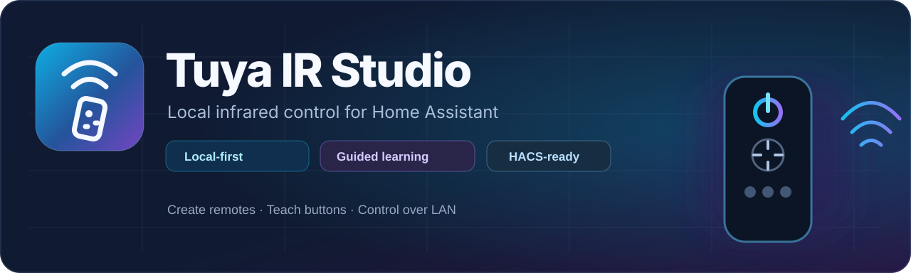
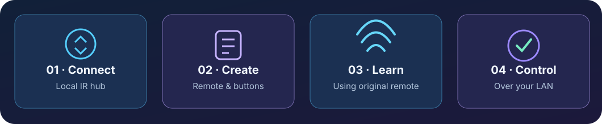

<p align="center"></p>

<p align="center"><a href="README.md">English</a> &nbsp;·&nbsp; <a href="README_RU.md">Русский</a> &nbsp;·&nbsp; <a href="README_DE.md">Deutsch</a> &nbsp;·&nbsp; <a href="README_FR.md">Français</a> &nbsp;·&nbsp; <a href="README_ES.md">Español</a> &nbsp;·&nbsp; <a href="README_ZH.md">中文</a></p>

<p align="center">
  <a href="https://github.com/Joka-kun/tuya-ir-studio/actions/workflows/tests.yaml"></a>
  <a href="LICENSE"></a>
  <a href="https://hacs.xyz/"></a>
</p>

# Tuya IR Studio

**Локальные ИК-пульты для Home Assistant.** Подключай совместимый ИК-шлюз Tuya, создавай пульты, обучай команды оригинальным физическим пультом и управляй устройствами по домашней сети.

**Что важно:** Экспериментальный импорт кнопок Smart Life удалён: он переносил технические названия без работающих ИК-сигналов. **QR теперь используется только для настройки шлюза**, а не для получения кнопок или готовых облачных кодов.

<p align="center"></p>

## Возможности

| Функция | Что делает |
| --- | --- |
| Подключение шлюза | Вход через QR Smart Life / Tuya или ручной ввод IP, Device ID и Local Key |
| Управление пультами | Через стандартную кнопку «Настроить»: создание, обучение, переименование и удаление. Расширенная панель необязательна |
| Обучение | Пошаговое получение настоящего ИК-сигнала с оригинального пульта |
| Сущности Home Assistant | Для пульта создаётся устройство и сущность `remote`, для обученных команд — отдельные сущности `button` |
| Дополнительно | Импорт совместимых Flipper `.ir`-файлов и резервные копии |
| Хранение | Профили и ИК-сигналы остаются в Home Assistant; для отправки облако не требуется |

## Установка

В **HACS → Пользовательские репозитории** добавь адрес:

```text
https://github.com/Joka-kun/tuya-ir-studio
```

Выбери категорию **Интеграция**, установи Tuya IR Studio и перезапусти Home Assistant. Открой **Настройки → Устройства и службы → Добавить интеграцию → Tuya IR Studio**. Подключи шлюз через QR или вручную.

Открой **Настройки → Устройства и службы → Tuya IR Studio → Настроить**. Здесь можно создать пульт, обучить кнопку, переименовать или удалить команды без отдельной боковой панели. На новых установках она скрыта и включается только по желанию. Для автоматизаций используй `button.press` или `remote.send_command`.

## Совместимость и ограничения

- Поддерживаются совместимые ИК-шлюзы Tuya, включая устройства семейства YRC11; реальные возможности зависят от прошивки, протокола и реализации приёма/передачи ИК.
- Нужен **инфракрасный** пульт. Bluetooth, RF, Wi-Fi и HDMI-CEC напрямую не обучаются.
- Кондиционеры могут отправлять полный пакет состояния, поэтому отдельная кнопка не всегда соответствует независимому коду.
- QR используется **только для подключения шлюза**. Названия, схемы и коды облачных пультов Smart Life автоматически не импортируются. Приложение ничего не подставляет по типу устройства.
- Обученные команды можно отправлять по LAN без Интернета, когда локальный шлюз доступен. Для первоначального QR-входа связь с Tuya может понадобиться.

## Документация

[Мастер «Настроить»](docs/NATIVE_CONFIGURE.md) · [Устройства и сущности Home Assistant](docs/HA_ENTITY_MODEL.md) · [Подключение шлюза](docs/TUYA_ONBOARDING_RU.md) · [Импорт готовых .ir-кодов](docs/OFFLINE_IR_CODE_FILE_IMPORT.md) · [План развития](ROADMAP.md) · [История изменений](CHANGELOG.md) · [Участие в разработке](CONTRIBUTING.md) · [Безопасность](SECURITY.md)

Ошибки и предложения: [GitHub Issues](https://github.com/Joka-kun/tuya-ir-studio/issues). Указывай модель шлюза, протокол, версию Home Assistant и шаги воспроизведения, **но не публикуй** Local Key, QR-токены и приватные идентификаторы.

MIT · Независимый проект, не связанный официально с Tuya или Home Assistant.
